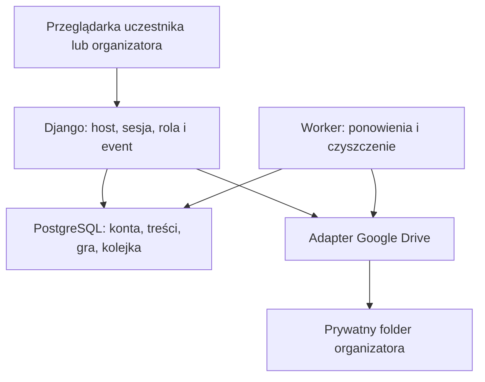

# Appka eventowa KC SSPW — specyfikacja PoC i samowystarczalny prompt

Stan: 23.10.2026. Wersja 1.0. Cały dokument można przekazać osobnemu chatowi implementacyjnemu jako jego instrukcję. Nie wymaga znajomości poprzedniej rozmowy.

## 1. Polecenie dla chatu implementacyjnego

Zaimplementuj lokalny PoC aplikacji eventowej KC SSPW według tego dokumentu, w repo https://github.com/kc-sspw/appka-eventowa. Właściciel zakończył opis wizji i przekazał decyzje techniczne do opracowania, preferując Django. Poniższe rozstrzygnięcia techniczne są świadomymi założeniami projektowymi, a nie cytatami z jego wypowiedzi. Nie otwieraj ponownie całej dyskusji o zakresie. Zgłaszaj tylko rzeczywiste blokady albo konieczne odstępstwa.

Najpierw odczytaj aktualne repo, ewentualne AGENTS.md, README, CONTRIBUTING.md, docs/POC_START_HERE.md, docs/requirements.md, docs/reference-inventory.md, docs/poc-readiness.md i docs/source-provenance.md. Niniejsza specyfikacja zastępuje wcześniejsze otwarte wymagania i propozycję automatycznej retencji zdjęć przez 30 dni. Zachowaj zasady repo dotyczące PR, autorstwa i odrębnego wdrożenia.

Pracuj od aktualnego main na nowej gałęzi feat/django-event-poc (jeśli zajęta, wybierz nową nazwę). Nie nadpisuj cudzej pracy. Dokumentację zacznij od docs/requirements.md, ADR-ów w docs/decisions/, docs/implementation-plan.md oraz docs/IMPLEMENTATION_PROMPT.md. Przenieś do nich odpowiednie części tej specyfikacji. Uaktualnij status README i poc-readiness bez deklarowania testów, których nie wykonano. Nie zmieniaj historycznego audytu tak, jakby był aktualnym audytem nowej aplikacji.

Zbuduj działający przepływ i testy, nie sam scaffold czy makietę. Korzystaj z referencji wskazanych niżej. Nie uruchamiaj ich deploymentów ani nie modyfikuj repozytoriów referencyjnych. Pracuj na fikcyjnych uczestnikach i generowanych obrazach. Brak poświadczeń Google nie blokuje implementacji adaptera i testów lokalnych; uniemożliwia natomiast deklarowanie sprawdzonej integracji live.

Zakaz bezpośredniego push/merge do main, force-pusha, produkcyjnego deploymentu i automatycznej wysyłki maili/SMS. Wynik: kod na gałęzi i reviewowalny draft PR, instrukcja startu, testy z rzeczywistym wynikiem, ograniczenia oraz lista spraw do pilotażu. Jeżeli nie masz prawa zapisu, przygotuj lokalny commit/diff i zgłoś konkretną blokadę. Nie obchodź Rulesetu.

## 2. Potwierdzone wymagania właściciela

- Produkt jest mobilnym hubem informacyjnym wydarzenia z grą fotograficzną.
- Jedna aplikacja obsługuje od początku wiele odizolowanych wydarzeń pod osobnymi subdomenami. Pierwszy realny pilot będzie jeden; test izolacji dwóch wydarzeń należy do PoC.
- Administrator platformy tworzy wydarzenie i przekazuje administrację organizatorom. Organizator zarządza wyłącznie swoim wydarzeniem.
- Konta uczestników są per wydarzenie, tworzone ręcznie lub z eksportu Excel z Forms. Organizator sam przekazuje loginy i hasła, np. mailem.
- Import zwraca dane wejściowe z dwiema dodatkowymi kolumnami login i hasło. PESEL, e-mail i pozostałe zbędne dane nie mają być przechowywane przez aplikację. Przechowujemy maksymalnie imię jako opis osoby oraz niezbędne dane techniczne.
- Uczestnik może należeć do kilku grup. Treści mają odbiorców: wszyscy albo wybrane grupy.
- Aktualności działają niezależnie. Stałe informacje i opcjonalny plan ramowy znajdują się w zakładce Informacje, pojawiającej się dopiero, gdy odbiorca ma dostępną treść.
- Harmonogram tworzy organizator prostym formularzem na stronie. Import Word/PDF/Excel harmonogramu nie jest potrzebny.
- Gra rusza w terminie organizatora, pokazuje instrukcję i umożliwia losowanie z puli. Limit: 5 niezrealizowanych zadań jednocześnie, nie 5 zdjęć na cały wyjazd.
- Jedno aktualne zdjęcie na przydzielone zadanie, z możliwością podmiany przed końcem gry. Gra indywidualna; uczestnicy mogą wykonywać zadania razem poza modelem aplikacji.
- Wspólna galeria wydarzenia, własne zadania/zdjęcia, komentarze, oddzielne oceny organizatorów i uczestników, moderacja. Bez rankingu.
- Pierwszy magazyn zdjęć: Google Drive organizatora. Po wydarzeniu zewnętrzny album pozostaje pod jego opieką i jest udostępniany poza aplikacją.
- Zamknięcie odbiera dostęp pod subdomeną i usuwa dane operacyjne aplikacji. Archiwum ma być minimalne.

## 3. Zakres i priorytety

| Priorytet | Elementy | Warunek odbioru |
|---|---|---|
| MUST | Eventy, role, logowanie, konta, grupy, import lokalny i eksport dostępów | Organizator przygotowuje dwa wydarzenia bez ujawniania danych między nimi |
| MUST | Aktualności, stałe informacje, harmonogram z odbiorcami | Dwa konta z różnych grup widzą właściwe treści i zakładki |
| MUST | Instrukcja/start gry, pula, losowanie, limit 5, zdjęcie/podmiana | Pełna droga od wylosowania do potwierdzonego zdjęcia i nowego losowania |
| MUST | Galeria, komentarze, oceny w dwóch kategoriach, moderacja | Widoczna interakcja kilku kont, egzekwowana serwerowo |
| MUST | Adapter Google Drive, lokalny adapter testowy, odzyskiwanie po błędach | Testy kontraktowe i udokumentowany test live albo jawny brak jego wykonania |
| MUST | Zamknięcie i czyszczenie, minimalne archiwum | Dane A znikają, dane B pozostają, album A nie jest automatycznie usuwany |
| SHOULD | Drobne usprawnienia formularzy i widoków pustych, wygodne filtry galerii | Nie mogą opóźniać MUST; podstawowa używalność i dostępność są obowiązkowe |
| LATER | SMS, push, OneDrive, drużyny gry, ranking, live WebSocket, szersze testy obciążenia | Nie dodawać implementacji do pierwszego PoC |
| OUT | Samodzielna rejestracja, PESEL/e-mail w bazie uczestników, publiczna galeria podczas gry, pełny CRM, import harmonogramu, natywna aplikacja | Brak tych przepływów i niepotrzebnych danych |

PoC jest etapowany technicznie, ale zakończenie samego pierwszego pionowego wycinka nie oznacza ukończenia całego zakresu MUST.

## 4. Architektura — ADR-001

Decyzja projektowa: modularny monolit Django 5.2 LTS, najnowsza dostępna poprawka bezpieczeństwa tej linii w dniu implementacji, Python 3.13, PostgreSQL 17. Wersje zależności przypnij po weryfikacji kompatybilności. Django templates + zwykłe formularze + niewielki JavaScript dla importu, uploadu i ocen. Bez osobnej SPA, Fluttera, Springa, PHP-runtime i DRF w pierwszym PoC.

Django daje wspólną obsługę sesji, formularzy, CSRF, ORM i migracji. PostgreSQL stosujemy również w testach współbieżności: kontrola limitu zadań i finalizacji zdjęć wymaga transakcji i blokad. Django admin służy wyłącznie administracji platformą; organizator dostaje dedykowany panel z filtrowaniem wydarzenia.

Moduły: events (cykl życia), accounts (konta i import), information (wpisy i harmonogram), game (zadania, przydziały, interakcje), media_storage (Drive i operacje plikowe). Podział wewnątrz jednego projektu, nie mikroserwisy.

Uruchomienie: Docker Compose z web, PostgreSQL i workerem korzystającym z tej samej bazy. Worker wykonuje prostą kolejkę operacji zapisaną w DB i okresowe czyszczenie; bez Redis/Celery na start. Rekord zadania ma status, liczbę prób, next_attempt_at i lease_until. Zawieszone prace można odzyskać po restarcie. PoC ma mały ruch; kolejkę da się później zastąpić bez zmiany logiki domeny.

Frontend nie buforuje prywatnych danych w service workerze ani localStorage. Domyślnie brak PWA/offline cache. JavaScript i parser XLSX są dostarczane lokalnie, z przypiętą wersją; brak skryptów analitycznych i zewnętrznych CDN na stronie importu.

## 5. Eventy, konta i uprawnienia — ADR-002

Event rozpoznajemy wyłącznie z zatwierdzonego hosta/subdomeny, np. event-a.events.example.org. Nie ufamy event_id z formularza, query string ani dowolnemu X-Forwarded-Host. W produkcji jedna konfiguracja wildcard DNS/TLS kieruje ruch do aplikacji; utworzenie eventu dodaje rekord, nie osobny deployment. Domena i infrastruktura pozostają parametrami wdrożenia. Lokalnie dwa hosty w hosts/konfiguracji proxy, bez zależności od publicznego DNS.

Sesja cookie host-only, HttpOnly, SameSite=Lax, Secure przy HTTPS. Brak wspólnego SESSION_COOKIE_DOMAIN dla eventów. Każdy odczyt, zapis, download i zadanie workera weryfikuje kontekst eventu; UUID nie zastępuje uprawnień. Nieznany slug odrzucamy. Dla wyczyszczonego wydarzenia pokazujemy neutralne 410 bez danych, nawet jeśli wildcard DNS nadal je obsługuje. Nie przydzielamy starego slugu nowemu wydarzeniu.

Najprostszy model PoC: eventowe konta organizatorów i uczestników oraz oddzielne konta administratorów platformy. Ta sama osoba obsługująca dwa wydarzenia może dostać dwa konta organizatora. Login wewnętrzny globalnie losowy/unikalny, ale logowanie wymaga właściwego eventu. Imię nie jest identyfikatorem. Brak obowiązkowych maili/telefonów. Organizator ma is_staff=false; rola jest nadawana przez administratora platformy, nigdy przez publiczny formularz.

| Operacja | Uczestnik | Organizator wydarzenia | Administrator platformy |
|---|---|---|---|
| Tworzenie eventu i nadawanie organizatorów | Nie | Nie | Tak |
| Import/ręczne konta/reset uczestnika | Nie | Własny event | Wyłącznie jawna pomoc administracyjna |
| Grupy, publikacje, harmonogram, pula i start gry | Odczyt dostępnych treści | Własny event | Pomoc administracyjna |
| Podłączenie dysku i zamknięcie eventu | Nie | Własny event | Tak |
| Losowanie i zdjęcie | Własne przydziały | Podgląd/moderacja; test gry przez osobne konto testowe | Brak automatycznej roli gracza |
| Galeria i komentarze | Własny event | Własny event | Brak domyślnej galerii wszystkich eventów |
| Ocena uczestnika | Cudze zdjęcie, 1–5 | Nie | Nie |
| Ocena organizatora | Nie | 0–5 we własnym evencie | Nie domyślnie |
| Usuwanie zdjęć i komentarzy | Własny komentarz | Własny event | Jawna interwencja administracyjna |

Uprawnienia platformowe są technicznie uprzywilejowane, ale nie powinny przypadkowo omijać event scope w zwykłym widoku. Obce ID zwracają 404, brak uprawnień do operacji we własnym evencie 403. Nie przekazuj klientowi hashy haseł, tokenów, sekretów ani całych encji użytkownika. Reset hasła unieważnia wcześniejsze sesje konta. Limit prób logowania i uploadów egzekwuj na serwerze.

## 6. Import Excela — ADR-003

Obsługujemy standardowy .xlsx z eksportu Forms. Nie obiecujemy dowolnej zgodności z makrami, plikami szyfrowanymi, XLS i skomplikowanymi workbookami. Parser dobierz spośród utrzymywanych bibliotek z właściwą licencją; nie instaluj bezrefleksyjnie starej paczki o znajomej nazwie.

1. Przeglądarka otwiera plik lokalnie. Organizator wybiera arkusz, wiersz nagłówków, kolumnę imienia oraz opcjonalnie kolumnę grupy. Jeżeli jest tylko pełne imię i nazwisko, wymagaj przygotowania osobnej kolumny imienia; nie wysyłaj pełnego nazwiska na serwer i nie zgaduj automatycznie jego granic.
2. Podgląd pokazuje liczbę kont, puste imiona i mapowanie grup. Jednakowe imiona są dozwolone. Nie wysyłamy źródłowych komórek, numerów PESEL, maili ani skrótów tych wartości.
3. Browser tworzy losowy batch_id, techniczne UUID wierszy, losowe loginy i hasła przez Web Crypto (co najmniej 128 bitów losowości na hasło). Trzyma je wyłącznie w pamięci bieżącej karty. API otrzymuje tylko allowlistę: row_id, imię, group_ids, login, initial_password. Hasło przechodzi przez HTTPS i jest natychmiast hashowane przez Django; nie zapisujemy jawnego hasła w bazie, logach, kolejce ani cache.
4. Serwer w jednej transakcji tworzy batch i konta; waliduje wszystkie grupy i event. Klucz (event,batch_id,row_id) zapewnia idempotencję. Retry tego samego batcha nie resetuje haseł i nie tworzy nowych kont. Niezgodny payload istniejącego batcha zwraca konflikt. Odpowiedź nie zawiera haseł.
5. Po sukcesie browser zapisuje nowy .xlsx z zachowaniem wartości, kolejności wierszy i arkuszy oraz dodaniem login/hasło na końcu wybranego arkusza. Nie gwarantujemy identycznego bajtowo pliku i wszystkich zaawansowanych stylów Excela. To standardowy eksport Forms, nie uniwersalny edytor Office. Wartości wyglądające jak formuły pozostają tekstem i nie tworzymy nowych aktywnych formuł. Testuj PESEL z zerem wiodącym i długie identyfikatory.
6. Po utracie odpowiedzi ta sama karta może ponowić batch i pobrać wynik, bo ma hasła w pamięci. Po zamknięciu karty bez pobrania wyniku konieczny jest reset odpowiednich kont. Nie odzyskuj haseł z serwera. Pokaż to przed zatwierdzeniem.

Reimport wynikowego pliku: istniejące loginy przyporządkowujemy tylko we własnym evencie; puste loginy oznaczają nowe osoby, nieznane/obce loginy są błędem. Nie nadpisujemy haseł istniejących kont ani nie udajemy, że dawna kolumna hasło nadal jest aktualna. Reimport pierwotnego pliku bez loginów może utworzyć duplikaty: wyraźny podgląd i ostrzeżenie, bez deduplikacji po imieniu. Import nie służy do masowego aktualizowania istniejących osób; grupy edytuje się w panelu.

Wyeksportowany plik nadal zawiera oryginalne dane organizatora i jawne dostępy; aplikacja go nie archiwizuje. Test przeglądarkowy ma dowieść, że zbędne kolumny nie występują w żadnym żądaniu sieciowym.

## 7. Informacje i harmonogram

Entry: typ NEWS albo STATIC, tytuł, zwykła treść tekstowa z bezpiecznym formatowaniem, pinned, published_at, audience=ALL lub GROUPS i lista grup. ALL nie wymaga technicznej grupy „wszyscy”; wynika z członkostwa w evencie. GROUPS wymaga co najmniej jednej grupy; widoczność jest sumą przynależności, nie przecięciem. Organizator widzi wszystkie wpisy swojego wydarzenia.

Aktualności: przypięte na górze, potem najnowsze. Stałe informacje: osobne wpisy, mogą powstać podczas wyjazdu. Przypięcie aktualności nie kopiuje automatycznie treści do STATIC — organizator wybiera właściwy typ. Harmonogram: starts_at, opcjonalny ends_at, title, location, description i odbiorcy. Koniec nie może być wcześniejszy od początku. Strefa domyślna Europe/Warsaw, zapis UTC; formularz pokazuje lokalny dzień i godzinę. Sortowanie po czasie, grupowanie po dniu. Miejsca zbiórek, śniadań i sal są treścią wpisów lub lokalizacją pozycji.

Zakładka Informacje pojawia się tylko wtedy, gdy użytkownik ma widoczny STATIC lub element harmonogramu. Sekcja Plan ramowy tylko przy widocznych pozycjach. Przypięcia i obecność zakładek obliczaj po filtracji uprawnień. Odświeżenie strony wystarcza w PoC.

## 8. Reguły gry — ADR-004

Organizator ustawia instrukcję oraz game_starts_at i game_ends_at; koniec gry nie później niż koniec eventu. Zegar serwera jest rozstrzygający. Przed startem: instrukcja i informacja o terminie, brak losowania/uploadu. Podczas gry: losowanie jednej pozycji na kliknięcie, maksymalnie pięć aktywnych. Po końcu gry do zamknięcia eventu: oglądanie, komentarze i oceny; brak losowania i podmian. Bez powiadomień push i bez wymogu fotografowania dwiema kamerami.

Przyjmujemy następujące dodatkowe decyzje projektowe:

- Zadanie nie wraca tej samej osobie, również po wykonaniu. To świadoma zmiana względem referencji, której getAvailableTasksForUser wyklucza tylko przydziały niewykonane.
- Losujemy spośród jeszcze nieprzydzielonych tej osobie aktywnych zadań o najmniejszej liczbie dotychczasowych przydziałów w evencie; remisy rozstrzygamy losowo. Dzięki temu początek gry rozkłada zadania po puli. Po wyczerpaniu brak kolejnego losowania i czytelny komunikat.
- Limit 5 i przydział sprawdzamy w jednej krótkiej transakcji. Dla małego PoC blokujemy rekord Event przy wszystkich losowaniach i finalizacjach zmieniających liczbę aktywnych zadań; dalej stała kolejność blokad Event → Assignment. Nie trzymamy blokad podczas połączenia z Drive.
- Brak zamiany/odrzucania wylosowanego zadania. Organizator może wycofać wadliwe zadanie: przydziały niewykonane stają się anulowane i zwalniają miejsca, zdjęcia ukończonych pozostają. Zadania już przydzielonego nie zmieniamy znaczeniowo; poprawę robimy przez wycofanie i nowe zadanie.
- Poprawne potwierdzenie pliku na Drive oraz commit statusu COMPLETED zwalnia miejsce. Nie czekamy na ocenę. Błąd lub trwający upload miejsca nie zwalnia.
- Po moderacyjnym usunięciu zdjęcia przydział ma stan REMOVED, nie wraca do puli i nie staje się szóstym niezrealizowanym zadaniem. Autor nie może go przywrócić podmianą. To proste rozstrzygnięcie PoC, widoczne w panelu.

Podmiana: stara wersja pozostaje widoczna do sukcesu nowej; awaria zachowuje starą. Sukces atomowo przełącza current_photo i usuwa oceny oraz komentarze starego zdjęcia, ponieważ dotyczą innego obrazu. Formularz uprzedza o tym przed potwierdzeniem. Stary plik trafia do kolejki usunięcia z Drive; nie gromadzimy historii zdjęć. Konkurencyjne podmiany wykrywa expected_version; przegrywający request nie nadpisuje nowszego zdjęcia, a jego osierocony plik jest sprzątany.

Galeria wszystkich uczestników eventu: najnowsze zdjęcia, paginacja 24 elementy, lazy-loading; autor wyświetlany jako imię i neutralny publiczny numer uczestnika, nie login do konta. Panel Moje zadania dzieli aktywne, wykonane i anulowane/usunięte. Brak rankingu i odznak top 3.

Oceny: jeden edytowalny głos uczestnika 1–5 na aktualne zdjęcie innej osoby; pokazuj średnią, liczbę głosów i własny głos. Jedna wspólna ocena organizatorów 0–5 na zdjęcie, ostatnia edycja z oznaczeniem organizatora. Nie uśredniaj jej z ocenami uczestników. To doprecyzowanie techniczne skali i współpracy organizatorów.

Komentarze: uczestnicy i organizatorzy, do 1000 znaków, zwykły tekst z escapowaniem, bez załączników/HTML. Autor może skasować własny, organizator dowolny we własnym evencie. Bez wątków i edycji komentarza w PoC. Serwerowe ograniczenie częstotliwości; brak komentarzy i ocen do ukrytego zdjęcia.

## 9. Zdjęcia i Google Drive — ADR-005

Pierwsza integracja: własny My Drive organizatora, folder tworzony przez aplikację. Nie implementujemy arbitralnego shared link jako uprawnienia do zapisu, Google Shared Drives ani konta serwisowego jako obejścia OAuth. Uczestnik nie łączy własnego Google.

Organizator łączy konto przez OAuth authorization-code flow ze scope drive.file, state jednorazowym i powiązaniem sesji, organizatora oraz wydarzenia. Tokeny dostępne wyłącznie backendowi, szyfrowane kluczem spoza bazy/Git, redagowane w błędach. Callback na jednym skonfigurowanym hoście platformy: jednorazowy stan łączy go z wyjściowym eventem, powrót tylko do hosta z allowlisty. Nie polegaj na cookie innej subdomeny ani na dowolnym next URL. Zgoda Google może obejmować pliki aplikacji z więcej niż jednego eventu tego właściciela, więc drive.file nie zastępuje izolacji w backendzie.

Na start jeden folder i połączenie eventowe, bez zmiany właściciela magazynu w trakcie gry. Ponowne połączenie musi odtworzyć dostęp do dotychczasowego folderu. Folder prywatny podczas gry. Link do folderu widoczny organizatorowi; uczestnicy pobierają zdjęcia przez backend po autoryzacji, nie bezpośrednio przez publiczne URL-e Drive.

Pipeline:

1. Request sprawdza event, rolę, przydział, termin, expected_version, idempotency_key oraz rezerwuje operację i budżet miejsca.
2. Odbiera obraz do prywatnego pliku tymczasowego; limit wejścia 15 MiB i 40 megapikseli. Walidacja rzeczywistego formatu, nie samego rozszerzenia. Obsługuj JPEG/PNG/WebP; HEIC poza pierwszym PoC z komunikatem o konieczności konwersji. Sprawdź upload z aparatu Android/iPhone; nie deklaruj wsparcia wszystkich formatów telefonu.
3. Pillow: popraw orientację, usuń EXIF/metadane lokalizacyjne, zmniejsz dłuższy bok do 1920 px, zapisz JPEG maks. 1 MiB, obniżając jakość/rozmiar w razie potrzeby. To nowe limity projektowe, a nie istniejąca gwarancja referencji.
4. Adapter zapisuje na Drive pod losową nazwą bez imienia/loginu. Status READY dopiero po potwierdzeniu dostawcy. Id operacji przechowuj także w appProperties; po timeout najpierw szukaj rezultatu tej operacji, nie twórz ślepo następnej kopii.
5. Krótka transakcja finalizacji sprawdza ponownie status eventu, czas i wersję. Jeżeli zamknięcie/konflikt wygrał, nie publikuj zdjęcia, zaplanuj usunięcie osieroconego pliku. Jeśli commit się udał, pokaż sukces i zwolnij miejsce aktywnego zadania.
6. W finally usuń plik tymczasowy; po awarii procesu worker usuwa pliki starsze niż 1 godzinę. Retry po utracie wejściowego pliku może wymagać ponownego wyboru zdjęcia przez użytkownika. Nie twórz trwałej kolejki binarnych uploadów w bazie.

Adapter ma kontrakt create_event_folder, upload(operation_id), find_by_operation, read(file_id), delete(file_id), check_access. Przy delete 404 traktuj jako osiągnięty cel. Backend przyjmuje ID zdjęcia aplikacji, nigdy dowolny file_id od użytkownika. Download korzysta z autoryzowanego files.get alt=media. Dla galerii generuj miniatury w ograniczonym prywatnym cache; TTL maks. godzina i globalny limit 256 MiB dla PoC. Oryginały tylko strumieniowo. Nagłówki dla prywatnej treści: Cache-Control: private, no-store. Cache usuwaj natychmiast przy moderacji/podmianie/zamknięciu; klucz zawiera event i wersję zdjęcia.

Usunięcie przez organizatora: potwierdzenie w UI, POST z CSRF, natychmiastowe ukrycie i usunięcie ocen/komentarzy; kolejka usuwa tylko ten plik utworzony przez aplikację. W PoC to trwałe usunięcie przez API, nie przeniesienie do kosza. Panel pokazuje pending/failed i możliwość ponowienia; nie udaje, że plik zniknął, jeżeli Google odmówił. Awaria dysku nie blokuje aktualności i harmonogramu, ale blokuje nowe skuteczne zgłoszenia.

Domyślny budżet zapisanych zdjęć wydarzenia: 2 GiB, konfigurowalny przez organizatora w granicach ustawień platformy. Budżet obejmuje pending reservations i nieusunięte stare pliki, nie tylko widoczną galerię; nie zastępuje rzeczywistego limitu konta Google. Przekroczenie zwraca zrozumiały błąd bez zaliczenia zadania. Worker zwalnia rezerwacje po rozstrzygnięciu operacji. Przykład: 200 osób × 50 zadań × 1 MiB ≈ 9,8 GiB; pięć aktywnych zadań nie ogranicza liczby wszystkich zdjęć do 1000. Nie obiecuj, że każde wydarzenie zmieści się w darmowym koncie.

Lokalny FakeStorage realizuje ten sam kontrakt w prywatnym katalogu, obsługuje symulowane timeouty/brak miejsca/odmowę. Wolno go używać tylko w development/tests; konfiguracja produkcyjna musi odmówić startu z takim adapterem. PoC ma zawierać prawdziwy adapter Drive i instrukcję OAuth, nawet gdy live test jest jeszcze niewykonany.

## 10. Zamknięcie — ADR-006

Event: DRAFT → ACTIVE → CLOSING → CLOSED. Ustawiona data końca lub ręczna akcja organizatora inicjuje CLOSING. Zamknięcie jest nieodwracalne w PoC; osobny ekran potwierdzenia pokazuje skutki i folder, który należy zachować. Termin końca eventu jest osobny od końca gry, aby można było jeszcze obejrzeć/ocenić zdjęcia.

Wejście w CLOSING natychmiast blokuje uczestników i nowe operacje gry; panel organizatora ma wyłącznie stan porządkowania. Każdy request dodatkowo sprawdza ends_at, więc opóźnienie workera nie przedłuża dostępu. Trwające uploady nie mogą opublikować nowych zdjęć po rozpoczęciu zamknięcia. Worker kończy lub anuluje operacje, usuwa osierocone i już wskazane do usunięcia pliki. Nie usuwa aktualnego albumu.

Po rozliczeniu operacji usuwa konta uczestników i organizatorów danego eventu, grupy, wpisy, harmonogram, pulę/przydziały, komentarze/oceny, referencje plików, importy, sesje, tokeny, cache, tymczasowe pliki i dzienniki eventowe. Konta platformowe zostają. Jeśli błąd Google uniemożliwia sprzątnięcie pending delete, usuń zbędną treść, pozostaw tylko minimum operacji/folder/token potrzebne do retry i status cleanup_failed w CLOSING; nie oznaczaj CLOSED. Platform admin może ponowić lub po ręcznej weryfikacji usunięcia w chmurze zakończyć sprzątanie. Nie przetrzymuj całej bazy eventu dla jednego błędu plikowego.

Archiwum CLOSED: UUID, zarezerwowany slug, nazwa eventu, daty początku/końca, status, cleaned_at. Bez album URL, nazwisk, kont, liczb głosów, zdjęć i tokenów. Dane do diagnozy wyłącznie ogólne, bez payloadów i nazw plików użytkownika. Logi techniczne maks. 7 dni jako domyślne założenie; przed pilotem sprawdzić także reverse proxy. Lokalny PoC nie tworzy backupów. Dla wdrożenia proponujemy szyfrowane backupy z maks. 7-dniowym cyklem i procedurą ponownego czyszczenia CLOSED po restore przed udostępnieniem systemu; nie deklarować tego jako wdrożonego bez konfiguracji infrastruktury.

Usunięcie lokalnych tokenów nie jest równoznaczne z cofnięciem zgody całej aplikacji Google. Nie wykonuj bezmyślnie globalnego revoke mogącego zakłócić inne eventy tego konta; zapewnij instrukcję ręcznego odłączenia po zakończeniu wszystkich takich eventów.

Folder pozostaje własnością organizatora. Po zamknięciu moderacja i usunięcie albumu odbywają się w Google Drive. Siedem dni to propozycja organizacyjna dla albumu, nie timer aplikacji i nie automatyczna reguła Google. Dawna propozycja „aplikacja kasuje zdjęcia po 30 dniach” nie obowiązuje.

## 11. Minimalny model danych i kontrakty

| Model | Najważniejsze pola i ograniczenia |
|---|---|
| Event | UUID, unique slug, name, timezone, starts_at, ends_at, game times, instructions, state, storage_budget, cleaned_at |
| Account | UUID, event nullable tylko dla kont platformy, losowy unique login, password hash, first_name, public_number, role, active; brak PESEL/mail/telefon |
| Group / Membership | event, name; unique(account,group); wszystkie relacje muszą dotyczyć tego samego eventu |
| Entry / ScheduleItem | event, treść/pola planu, audience, dozwolone grupy |
| Task | event, description, active; niezmienny sens po pierwszym przydziale |
| Assignment | event, account, task, status, assigned_at; unique(account,task) |
| Photo | event, assignment, external_file_id, version, bytes, state; najwyżej jedno aktualne na assignment |
| ParticipantRating / OrganizerScore | photo + account/rater, value; unique(photo,participant) i jedna organizer score/photo |
| Comment | event, photo, author, text, created_at |
| ImportBatch / ImportRow | event, losowe batch/row IDs, account, stan; bez oryginalnych komórek i jawnych haseł |
| StorageConnection | event, folder ID, zaszyfrowane poświadczenia; bez publicznych linków w API uczestnika |
| StorageOperation | event, operation UUID, assignment/version, external file ID, action/status, reserved bytes, retry/lease; bez binariów i jawnych tokenów |

Event musi być zgodny także w relacjach pośrednich. Foreign key sam nie zapewnia zgodności eventu. Wymuś ją w warstwie serwisowej używanej przez wszystkie widoki/worker, walidacji formularzy i ograniczeniach DB tam, gdzie możliwe. Zakaz swobodnego zapisu modeli z niezaufanego payloadu. Indeksy na event + typowe sortowanie/filtry; paginacja i brak N+1 w galerii.

Przykładowe kontrakty, wszystkie na hoście eventu poza platformą i callbackiem:

| Endpoint | Zachowanie |
|---|---|
| POST /auth/login, /auth/logout | Sesja Django, CSRF, login w kontekście hosta |
| POST /organizer/imports | Batch allowlist + idempotencja; tylko organizator |
| POST /organizer/participants/{id}/reset | Nowe hasło, unieważnienie sesji; bez odczytu starego |
| GET /news, /information, /game, /gallery | Render HTML po filtrowaniu odbiorców |
| POST /game/draw | Jeden przydział; request ID zapobiega podwójnemu losowaniu przy retry |
| POST /assignments/{id}/photo | Multipart, idempotency key, expected_version; sukces dopiero po finalizacji |
| GET /photos/{id}/content lub /thumbnail | Prywatny odczyt, autoryzacja i status zdjęcia |
| POST /photos/{id}/rating, /score, /comments | Osobne role, ograniczenia i CSRF |
| POST /organizer/photos/{id}/delete | Ukrycie i kolejka usunięcia; nigdy mutation przez GET |
| POST /organizer/close | Potwierdzone przejście do CLOSING |

Formularze CRUD wpisów, planu, grup i zadań mają analogiczne endpointy panelu. JSON używany tylko, gdzie jest potrzebny, ze wspólną odpowiedzią success/data/error. 409 oznacza konflikt wersji/stanu, 413 rozmiar, 429 limit częstotliwości. Rozróżnij uploading, ready, failed, pending_delete. Nie kopiuj niespójnego kontraktu ratings.js z referencji.

## 12. Mapa rzeczywistego wykorzystania referencji

Odczytano dokumentację oraz wskazane niżej fragmenty źródeł; to analiza statyczna, bez uruchamiania aplikacji. Główne repo zawiera dokumentację i szablony współpracy, a nie gotowy backend. Nazwy są różne: appka-eventowa = produkt, apka-wyjazdowa = referencja Poligon.

Wersje main sprawdzone 23.10.2026:

- Produkt: https://github.com/kc-sspw/appka-eventowa/commit/2f2fcc097cc7407e6bcc08af887dc002685ebb8e
- Poligon: https://github.com/kc-sspw/apka-wyjazdowa/commit/2fc494ecaaa6ca5195c51f2cb4a3290b2fda0fb9
- Gra: https://github.com/Korniszon99/SSPWPhotoTaskGame/commit/77046c6806a6b09fa7442f7df11ccae1123f4b9f

Ścieżki P poniżej są względem src/main/java/me/havooc/poligon/ w Poligonie; G względem photo_game/ w grze.

| Funkcja | Zweryfikowane źródło | Decyzja wykorzystania i zmiana |
|---|---|---|
| Limit 5, losowanie | G actions/draw_task.php; database/database.php: getIncompleteTasksCount, getAvailableTasksForUser | Przepisać logikę w Django; zachować limit niewykonanych, dodać transakcję, wyrównanie przydziałów i brak powtórek ukończonych |
| Własne zadania ze zdjęciami | G elements/user_task_list_grid.php | Adaptować układ kart/statusów do templates; usunąć top 3, publiczne upload URL i zależności PHP |
| Upload/kompresja | G actions/upload_photo.php | Przepisać pipeline; zachować kontrolę własności i ideę kompresji/cleanup; dodać Drive, wersjonowanie, EXIF, idempotencję. Referencja odrzuca już wykonane zadania, więc podmiana jest nowa |
| Galeria | G gallery.php | Adaptować siatkę i paginację 24; odroczyć rozbudowane filtry/rankingi, dodać event scope i prywatne media |
| Oceny | G actions/rate_photo.php, js/ratings.js, database/schema.sql oraz ratePhoto w database.php | Zachować 1–5 i unikalny głos, przepisać kontrakt i umożliwić edycję. JS oczekuje success, którego odczytany endpoint nie zwraca; nie kopiować wprost. Ocena organizatora to nowy model |
| Moderacja zdjęcia | G actions/admin_delete_photo.php | Przepisać; w referencji parametry GET, tutaj POST+CSRF, event scope i kolejka Drive |
| Harmonogram | P model/ScheduleDay.java, model/ScheduleElement.java | Przepisać model dnia/czasu/opisu; zastąpić TrainingPath grupami odbiorców, dodać tytuł i miejsce |
| Ogłoszenia | P controller/AnnouncementController.java | Przenieść scenariusz publikacji/edycji i daty; odrzucić globalne findAll/broadcast, autora brać z sesji |
| Konta eventowe, import, komentarze, Drive, zamknięcie | Brak gotowego odpowiednika ustalonego przepływu w przejrzanych modułach | Nowa implementacja zgodna z niniejszą specyfikacją |
| Rankingi, Flutter, Firebase, WebSocket, SMS | Dokumentacja i inwentarz referencji | Poza pierwszym PoC; nie uruchamiać dodatkowych runtime'ów |

To jest reuse funkcjonalny i adaptacja wybranych widoków, nie obietnica bezpośredniego użycia PHP/Java w Django. Przy adaptacji rzeczywistego HTML/CSS/JS odczytaj cały kopiowany plik, zachowaj notice/autorów i wpisz dokładny source commit + ścieżkę + zakres zmian w source-provenance. W Poligonie odczytane nagłówki wskazują Łukasza Piętkę (FUT 2025). Autora konkretnego fragmentu gry ustal z pliku/historii, nie z samego loginu właściciela repo. Prawa do użycia kodu zostały potwierdzone przez właściciela projektu; nie przenosi to automatycznie licencji zależności czy prawa do cudzych znaków graficznych.

## 13. Plan implementacji i testy odbioru

Kolejność logicznych PR-ów (lub kolejnych commitów w draft PR, jeśli zależności utrudniają osobne PR-y):

1. Dokumentacja decyzji, Django/PostgreSQL, event resolver, konta/role, dwa eventy i testy izolacji.
2. Pionowy wycinek: organizer → konto → przydział → upload do FakeStorage → galeria → organizer score. Już tutaj atomowość limitu i prywatny download.
3. Import/eksport XLSX, grupy, aktualności, stałe informacje i harmonogram.
4. Prawdziwy Drive, OAuth, idempotencja, podmiana, moderacja, retry i limity miejsca.
5. Komentarze/oceny uczestników, pełne zamknięcie, instrukcje oraz całościowa weryfikacja.

Minimum testów automatycznych:

- A/B: uczestnik i organizator A nie odczytują ani nie zapisują obiektów B przez zmianę URL, body, group ID, assignment ID, photo ID, callback state lub job payload. Test również miniatur, eksportu/importu i cache.
- Sesja nie daje uprawnień na obcym hoście; uczestnik nie zmienia roli, eventu i właściciela. Nieznany host, nieznany slug i closed event nie ujawniają danych.
- XLSX: kilka identycznych imion, fikcyjny PESEL/mail, grupy, zachowane wartości; spy na sieć dowodzi braku zbędnych komórek. Retry tworzy jeden zestaw kont. Utrata wyniku/reset są udokumentowane.
- Treści: ALL + kilka grup, brak grup, ukryta zakładka, dodanie STATIC podczas eventu, plan sortowany po dniach. Próba XSS pozostaje tekstem.
- Gra: czas przed/w trakcie/po, brak puli, wyczerpanie, brak ponownego zadania, rozkład najmniej przydzielonych, limit 5, wycofanie zadania. Dwa równoczesne draw przy 4 aktywnych dają najwyżej 5; ponowienie tego samego requestu nie losuje drugiego.
- Upload: poprawny/niepoprawny MIME, zbyt duży obraz, limit pikseli, usunięte EXIF/GPS, orientacja, limit końcowy. Timeout Drive przed/po zapisie, pełny dysk, cofnięta zgoda, restart workera i błąd DB po uploadzie nie tworzą fałszywego sukcesu lub niekontrolowanych duplikatów.
- Podmiana: błąd zachowuje stare zdjęcie; sukces usuwa stare oceny/komentarze i planuje usunięcie starego pliku. Konkurencyjna podmiana nie gubi nowszego zdjęcia. Moderacja i zamknięcie wygrywają z uploadem bez późniejszego odtworzenia pliku w galerii.
- Oceny 1–5/0–5, brak samooceny uczestnika, jedna ocena na osobę, edycja nie zwiększa liczby głosów. Komentarze i usuwanie przestrzegają ról.
- Budżet miejsca: dwie równoczesne rezerwacje nie przekraczają limitu; pending delete nadal liczy się do zużycia do potwierdzenia usunięcia.
- Close A: odcięcie sesji, czyszczenie danych/cache/tokenów, zachowanie archiwum i istniejącego albumu, B nadal działa. Retry czyszczenia jest idempotentne, pending cloud failure nie daje fałszywego CLOSED.

Współbieżność testuj na PostgreSQL, nie traktuj SQLite jako dowodu działania blokad. Testy przeglądarkowe: mobilne 360–430 px i desktop, klawiatura/focus/etykiety, loading/error/success, brak poziomego overflow; przynajmniej pełny scenariusz dwóch uczestników i organizatora. Generuj obrazy testowe, nie kopiuj zdjęć z referencji.

Definition of done: instrukcja uruchomienia od zera, migracje, seed dwóch wydarzeń z kontami wygenerowanymi lokalnie (bez publicznego stałego hasła admina), komplet MUST, testy z wynikiem, brak sekretów/danych w Git, dokumentacja reuse, instrukcja organizatora i raport ograniczeń. Przykładowy zestaw syntetyczny może mieć 200 kont i 50 zadań w A oraz kilka kont w B; nie jest to gwarancja wydajności dla 200 jednoczesnych uploadów. Zmierz podstawowy scenariusz i opisz środowisko, bez deklarowania nieprzetestowanego SLA.

## 14. Instrukcja organizatora do opracowania wraz z działającym UI

W dokumentacji pokaż dokładne kroki zgodne z wykonanym panelem:

1. Odbierz event i dostęp organizatora; ustaw terminy, instrukcję gry, pulę i budżet miejsca.
2. Przygotuj eksport Forms, wybierz kolumnę imienia i grupy, zobacz podgląd, utwórz konta, pobierz wynik i rozdaj dostępy własnym kanałem. Przy zgubieniu resetuj konto.
3. Dodaj aktualności, stałe informacje i opcjonalne pozycje planu; sprawdź podgląd jako uczestnik danej grupy.
4. Połącz Google Drive, pozwól aplikacji utworzyć folder, sprawdź dostępne miejsce i wykonaj test na sztucznym zdjęciu. Wyjaśnij różnicę między autoryzacją Google a linkiem do folderu.
5. Monitoruj błędy uploadu/miejsca, moderuj komentarze i zdjęcia, oceniaj. W razie cofnięcia zgody ponownie połącz ten sam magazyn.
6. Przed zamknięciem zachowaj folder URL i upewnij się, że nie ma zaległych usunięć. Zamknięcie usuwa dane gry, nie album.
7. Po zamknięciu ustaw na Drive wybrane uprawnienia tylko do odczytu i roześlij link samodzielnie. Tryb „każdy z linkiem” może być przekazywany dalej; nie włączamy go automatycznie.
8. Po wybranym czasie, np. 7 dniach, usuń album bezpośrednio w Drive i opróżnij kosz, jeśli celem jest odzyskanie miejsca. Dostęp do innych plików właściciela ma pozostać nienaruszony.

Techniczną konfigurację projektu Google Cloud/OAuth wykonuje utrzymujący platformę, nie każdy organizator. W dokumentacji administratora opisz callback, zakres, sekrety i status publikacji OAuth. W trybie External/Testing token odświeżania dla używanych zakresów może wygasać po 7 dniach; to nie mechanizm retencji albumu. Sprawdzenie rzeczywistego OAuth i warunków usługi jest elementem przygotowania pilotażu, nie domysłem wynikającym z testów FakeStorage.

## 15. Źródła techniczne i granice weryfikacji

Dokumentacja pierwotna sprawdzona 23.10.2026:

- Django, wersje wspierane: https://www.djangoproject.com/download/ — linia 5.2 LTS z okresem wsparcia do kwietnia 2028; dokładną poprawkę weryfikować podczas instalacji.
- Zgodność Python/Django: https://docs.djangoproject.com/pl/5.2/faq/install/
- Scope Drive: https://developers.google.com/workspace/drive/api/guides/api-specific-auth — drive.file i ograniczanie dostępu do plików aplikacji.
- Pobieranie plików: https://developers.google.com/workspace/drive/api/guides/manage-downloads — files.get z alt=media.
- OAuth i wygasanie tokenów Testing: https://developers.google.com/identity/protocols/oauth2/

Nie zbadano działania nowej aplikacji, bo nie została jeszcze zaimplementowana. Nie wykonano live OAuth, testu uploadu Drive ani audytu infrastruktury. Bezpłatna pojemność i limity dostawcy mogą się zmieniać; ten dokument nie gwarantuje bezpłatnego hostingu ani nieograniczonego API. Nie powielamy wcześniejszej niezweryfikowanej prognozy cen API jako faktu.

Przed realnym pilotem osobno potwierdzić: środowisko i domenę/TLS, właściwe konto organizatora, zasady danych i udostępniania zdjęć, działanie OAuth, limity, backup/restore oraz testy telefonu i sieci wyjazdowej. Podpisane klauzule organizatorów nie zastępują ustalenia sposobu używania prywatnych kont chmurowych; to zależność organizacyjna, nie funkcja dodawana do PoC.

## 16. Raport do Mastera

Data: 23.10.2026. Projekt: appka eventowa.

Wykonano: zakończono analizę wizji, odczytano aktualne repo produktu i wybrane źródła obu referencji, opracowano zakres i samowystarczalną specyfikację/prompt. Dowód: ten dokument i przypięte wyżej commity źródeł. Nie wykonano implementacji, testów runtime ani zmian repozytoriów w czacie projektowym.

Decyzje właściciela: hub per event, import dostępów, grupy/plan, limit 5 aktywnych zadań, Drive, interakcje/moderacja, minimalne archiwum, preferencja Django. Decyzje projektowe w ramach delegacji: monolit Django/PostgreSQL, formularze templates, algorytm losowania, zasady podmiany i moderacji, limity plików i budżet, worker DB, szczegółowe stany zamknięcia.

Zależności: dostęp implementatora do repo, konfiguracja testowego OAuth, później infrastruktura i zgoda na pilot. Następny krok: właściciel przekazuje cały dokument chatowi implementacyjnemu; termin nie został ustalony. Brak zmian kalendarza. Do aktualizacji przy implementacji: wymagania/ADR/start/readiness w repo. Źródła ogólne SSPW z 8.10 mają nieaktualną propozycję automatycznej retencji 30 dni; nie zostały automatycznie zmienione.
