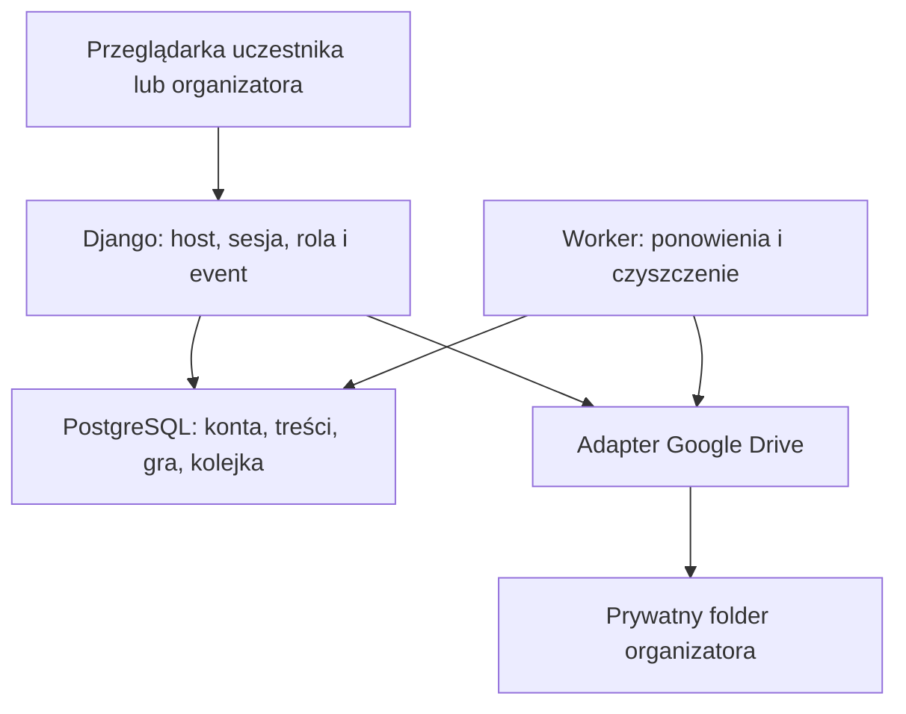

# ADR-001 — architektura

Status: zaakceptowane do lokalnego PoC (23.10.2026).

## 4. Architektura — ADR-001

Decyzja projektowa: modularny monolit Django 5.2 LTS, najnowsza dostępna poprawka bezpieczeństwa tej linii w dniu implementacji, Python 3.13, PostgreSQL 17. Wersje zależności przypnij po weryfikacji kompatybilności. Django templates + zwykłe formularze + niewielki JavaScript dla importu, uploadu i ocen. Bez osobnej SPA, Fluttera, Springa, PHP-runtime i DRF w pierwszym PoC.

Django daje wspólną obsługę sesji, formularzy, CSRF, ORM i migracji. PostgreSQL stosujemy również w testach współbieżności: kontrola limitu zadań i finalizacji zdjęć wymaga transakcji i blokad. Django admin służy wyłącznie administracji platformą; organizator dostaje dedykowany panel z filtrowaniem wydarzenia.

Moduły: events (cykl życia), accounts (konta i import), information (wpisy i harmonogram), game (zadania, przydziały, interakcje), media_storage (Drive i operacje plikowe). Podział wewnątrz jednego projektu, nie mikroserwisy.

Uruchomienie: Docker Compose z web, PostgreSQL i workerem korzystającym z tej samej bazy. Worker wykonuje prostą kolejkę operacji zapisaną w DB i okresowe czyszczenie; bez Redis/Celery na start. Rekord zadania ma status, liczbę prób, next_attempt_at i lease_until. Zawieszone prace można odzyskać po restarcie. PoC ma mały ruch; kolejkę da się później zastąpić bez zmiany logiki domeny.

Frontend nie buforuje prywatnych danych w service workerze ani localStorage. Domyślnie brak PWA/offline cache. JavaScript i parser XLSX są dostarczane lokalnie, z przypiętą wersją; brak skryptów analitycznych i zewnętrznych CDN na stronie importu.

